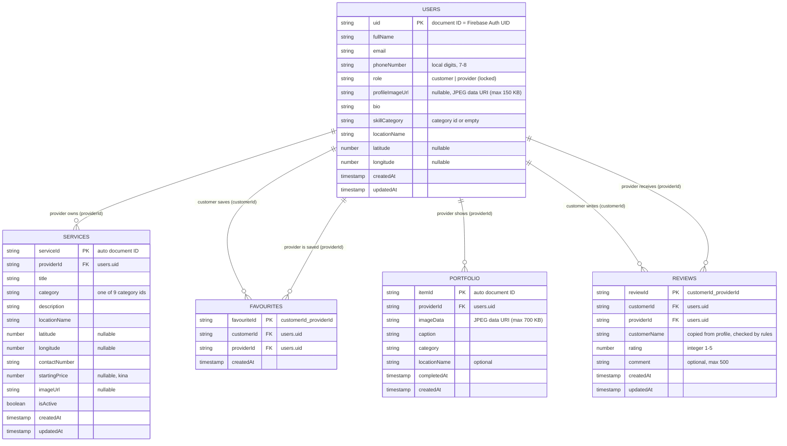
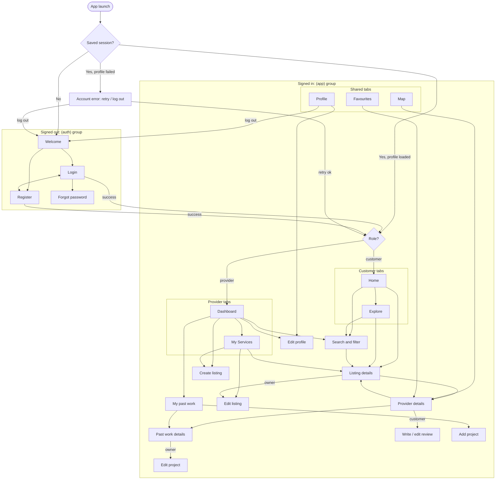

# Wantok Skills: Technical Report

**Student:** `[YOUR FULL NAME]` · **Student number:** `[YOUR STUDENT NUMBER]` · **Course:** IS325 Mobile App Development · **Date:** `[DATE]`

> **How to use this draft:** this file is the source for the PDF you submit. Items in `[SQUARE BRACKETS]` are evidence only you can supply (build IDs, screenshots, your reflection). Diagrams are written in Mermaid. GitHub renders them, or paste them into <https://mermaid.live> and export PNGs for the PDF.

---

## 1. Requirements

### 1.1 User roles

- **Customer:** looks for local skilled people and contacts them.
- **Service Provider:** advertises skills and manages service listings.

The role is chosen at registration and cannot be changed afterwards (enforced in `firestore.rules`).

### 1.2 User stories

**Must-have**

| #   | User story                                                                                                                                                                   | Status                       |
| --- | ---------------------------------------------------------------------------------------------------------------------------------------------------------------------------- | ---------------------------- |
| M1  | As a **new user**, I want to register with my name, email, phone number, password and account type, so that I can use the app as a customer or a provider.                   | Implemented                  |
| M2  | As a **registered user**, I want to log in and stay logged in after closing the app, so that I do not have to sign in every time.                                            | Implemented                  |
| M3  | As a **user who forgot my password**, I want to receive a reset email, so that I can regain access to my account.                                                            | Implemented                  |
| M4  | As a **provider**, I want to create a service listing with a title, category, description, location, phone number and optional price, so that customers can find my service. | Implemented                  |
| M5  | As a **provider**, I want to edit my listings, so that the details stay accurate.                                                                                            | Implemented                  |
| M6  | As a **provider**, I want to delete a listing after confirming, so that I can remove services I no longer offer.                                                             | Implemented                  |
| M7  | As a **customer**, I want to browse active listings by category, so that I can see what services are available.                                                              | Implemented                  |
| M8  | As a **customer**, I want to search by keyword, category and location, so that I can quickly find a suitable provider.                                                       | Implemented                  |
| M9  | As a **customer**, I want to view a listing's and a provider's details, so that I can decide whether to contact them.                                                        | Implemented                  |
| M10 | As a **customer**, I want to call or WhatsApp a provider from the app, so that I can arrange the job directly.                                                               | Implemented                  |
| M11 | As a **user**, I want to see providers on a map relative to my location, so that I can find help nearby.                                                                     | Implemented                  |
| M12 | As a **user**, I want my data protected so that others cannot change my profile or listings, so that I can trust the platform.                                               | Implemented (security rules) |

**Should-have**

| #   | User story                                                                                                                 | Status                                                                             |
| --- | -------------------------------------------------------------------------------------------------------------------------- | ---------------------------------------------------------------------------------- |
| S1  | As a **customer**, I want to save providers as favourites, so that I can find them again later.                            | Implemented                                                                        |
| S2  | As a **provider**, I want a dashboard showing my active and paused listings, so that I can manage my business at a glance. | Implemented                                                                        |
| S3  | As a **provider**, I want to edit my profile (skill, bio, location), so that customers know more about me.                 | Implemented                                                                        |
| S4  | As a **provider**, I want to pause a listing without deleting it, so that I can stop enquiries temporarily.                | Implemented                                                                        |
| S5  | As a **customer**, I want to see services near me on the Home screen, so that I find local help first.                     | Implemented                                                                        |
| S6  | As a **customer**, I want to see previously loaded listings when I am offline, so that poor connectivity does not stop me. | Partially: latest listings and own profile cached; details pages need a connection |

**Could-have**

| #   | User story                                                                                                        | Status                                                                                                                                                              |
| --- | ----------------------------------------------------------------------------------------------------------------- | ------------------------------------------------------------------------------------------------------------------------------------------------------------------- |
| C1  | As a **provider**, I want to upload a profile photo and listing photos, so that my services look trustworthy.     | Partially: profile and past-work photos work (compressed, stored in Firestore); listing photos built but disabled on the Spark plan (need Firebase Storage / Blaze) |
| C2  | As a **customer**, I want to rate and review providers, so that I can choose reliable people.                     | Implemented: one 1-5 star review per customer per provider, with optional comment                                                                                   |
| C3  | As a **customer**, I want to chat with a provider inside the app, so that I do not need to share my phone number. | Not implemented (WhatsApp/phone used instead)                                                                                                                       |

---

## 2. Data model

Cloud Firestore (NoSQL). Five top-level collections. Provider details are **not copied** into listings; listings store `providerId` and the app looks the provider up in `users`.

**Relationships**

- One **provider** (`users` with `role = provider`) owns **zero or many** `services`; each service belongs to exactly one provider.
- One **user** saves **zero or many** `favourites`; each favourite references one customer and one provider.
- One **provider** has **zero to twelve** `portfolio` items (past work).
- One **customer** writes **at most one** review per provider (`reviews` ID `customerId_providerId`); a provider receives many reviews. The average and count are calculated in the app from the provider's reviews rather than stored (Firestore's server-side `average()` with a `providerId` filter would need an extra composite index).
- Photos are stored as compressed JPEG data URIs inside Firestore documents because the Spark plan has no Cloud Storage.
- The favourite document ID `customerId_providerId` makes duplicates impossible and lets the rules check ownership without extra reads.

**Categories:** carpentry, plumbing, electrical, computer-repair, tutoring, tailoring, photography, gardening, graphic-design (`src/constants/categories.ts`).

---

## 3. Screen flow and authentication boundary

**Authentication boundary.** Expo Router _protected routes_ (`Stack.Protected` / `Tabs.Protected`) only register a group while its guard is true:

| Group / screens                                     | Guard                                     |
| --------------------------------------------------- | ----------------------------------------- |
| `(auth)`: Welcome, Login, Register, Forgot password | signed out (or still loading)             |
| `account-error`                                     | signed in but profile could not be loaded |
| `(app)`: all tabs and detail screens                | signed in **and** profile loaded          |
| Explore tab                                         | customer                                  |
| My Services tab, Create listing, Edit listing       | provider                                  |

Typing or deep-linking a URL to a screen whose guard is false redirects instead of opening it. The splash screen stays up until the saved session has been checked, so protected screens never flash. **Navigation guards are only UX**: the real enforcement is server-side in `firestore.rules`.

**Security rules summary** (`firestore.rules`):

- Everything is denied unless a rule allows it; every read requires sign-in.
- `users`: read own profile, or any **provider** profile; customer profiles are private. Create only your own document, with `role` in {customer, provider} and `email` matching the auth token. Update only your own document, and `uid`, `email`, `role` and `createdAt` cannot change.
- `services`: read active listings (or your own). Create only if your role is provider and `providerId` is your UID. Update/delete only your own; ownership cannot be transferred. Field types and lengths are validated.
- `favourites`: read/create/delete only your own; ID must be `uid_providerId`.
- `portfolio`: signed-in users read; only providers create, under their own UID; owner-only edit/delete; photo must be a JPEG data URI under 700 KB; completion date cannot be in the future.
- `reviews`: signed-in users read; only customers create, one per provider (ID `uid_providerId`), never for themselves, only for real providers, and `customerName` must equal their profile name; rating must be an integer 1-5; the author may edit only stars/comment, and delete their own review.

`[EVIDENCE: Rules were tested on the live project on 2026-11-05 using a temporary signed-in account (deleted afterwards): active-listings query → 200; unfiltered listing query → 403; read own profile → allowed (404, no document); anonymous query → 403. Add your own two-account tests here, e.g. customer attempting to edit a provider's listing.]`

---

## 4. API integration table

| API / service                     | Provider                        | Endpoints / calls used                                                                                                                                                                                                                       | Data used for                                                                                    | Rate limits (free tier)                                                                                                        | When the call fails                                                                                                                                                                                                                        |
| --------------------------------- | ------------------------------- | -------------------------------------------------------------------------------------------------------------------------------------------------------------------------------------------------------------------------------------------- | ------------------------------------------------------------------------------------------------ | ------------------------------------------------------------------------------------------------------------------------------ | ------------------------------------------------------------------------------------------------------------------------------------------------------------------------------------------------------------------------------------------ |
| **Firebase Authentication**       | Google Firebase                 | Via JS SDK → `identitytoolkit.googleapis.com/v1/accounts:signUp`, `:signInWithPassword`, `:sendOobCode` (password reset), `:update` (display name), `:delete` (registration rollback); `securetoken.googleapis.com/v1/token` (token refresh) | Accounts, login, password reset, persistent sessions                                             | 100 new accounts per hour per IP; 150 password-reset emails per day (Spark); 3,000 daily active users (Spark, tier 1)          | Firebase error codes are mapped to plain messages (e.g. "Incorrect email or password", "No internet connection"). If the profile write fails after sign-up, the Auth account is deleted so the user can retry.                             |
| **Cloud Firestore**               | Google Firebase                 | Via JS SDK → `firestore.googleapis.com`: `getDoc`, `getDocs` (queries on `isActive`, `providerId`, `customerId`), `addDoc`, `setDoc`, `updateDoc`, `deleteDoc`                                                                               | `users`, `services`, `favourites`                                                                | 50,000 document reads, 20,000 writes and 20,000 deletes per day; 1 GiB stored; 10 GiB egress per month                         | React Query retries once, then shows an error state with **Try again**. Favourite toggles roll back automatically. A profile that cannot load shows the Account error screen (retry / log out). Forms keep their input and show the error. |
| **Device location**               | Android OS via `expo-location`  | `requestForegroundPermissionsAsync`, `hasServicesEnabledAsync`, `getLastKnownPositionAsync`, `getCurrentPositionAsync` (15 s timeout), `reverseGeocodeAsync`                                                                                 | User position on the map, "Near you" distances, pinning listing/profile coordinates, place names | No app-level quota for GPS. Reverse geocoding uses the platform geocoder; `[CHECK: Android Geocoder limits are not published]` | Separate messages for permission denied (with **Open Settings** when Android will not ask again), location services off, and timeout. The map still shows all providers; forms let users type a location instead.                          |
| **Google Maps**                   | Google, via `react-native-maps` | Native Maps SDK for Android (map tiles, markers, camera)                                                                                                                                                                                     | Showing provider markers and the user's position                                                 | `[CHECK current Google Maps Platform quota/pricing for Maps SDK for Android]`                                                  | In Expo Go no key is needed. A compiled build without an API key shows a blank map. The web build shows a "map available in the mobile app" message instead of crashing.                                                                   |
| **WhatsApp click-to-chat**        | WhatsApp (Meta)                 | `https://wa.me/675XXXXXXXX?text=…` deep link                                                                                                                                                                                                 | Starting a chat with a provider                                                                  | None for opening links                                                                                                         | If the link cannot open, a message is shown under the buttons.                                                                                                                                                                             |
| **Phone dialler**                 | Android OS                      | `tel:+675XXXXXXXX` deep link                                                                                                                                                                                                                 | Calling a provider                                                                               | None                                                                                                                           | "This device cannot make phone calls."                                                                                                                                                                                                     |
| **Firebase Storage** _(optional)_ | Google Firebase                 | Via JS SDK → `firebasestorage.googleapis.com`: `uploadBytesResumable`, `getDownloadURL`, `deleteObject`                                                                                                                                      | Profile and listing photos (only the download URL is stored in Firestore)                        | Requires Blaze plan; `[add quotas if enabled]`                                                                                 | Disabled on Spark (controls hidden). When enabled: size/type checked before upload, progress shown, **Retry upload** on failure, old photos deleted only after the new one is saved.                                                       |

Sources for limits: Firebase Firestore quotas (firebase.google.com/docs/firestore/quotas) and Firebase Auth limits (firebase.google.com/docs/auth/limits), checked 2026-11-05.

---

## 5. Build record

| Build | Profile      | Output | EAS build ID | Date     | Result                 |
| ----- | ------------ | ------ | ------------ | -------- | ---------------------- |
| APK   | `preview`    | `.apk` | `[BUILD ID]` | `[DATE]` | `[Succeeded / Failed]` |
| AAB   | `production` | `.aab` | `[BUILD ID]` | `[DATE]` | `[Succeeded / Failed]` |

`[INSERT SCREENSHOT of the EAS dashboard showing both builds succeeded]`

**Configuration changes required for the compiled build** (record what you actually did):

- Firebase values added as EAS environment variables for `preview` and `production`, because `.env` is git-ignored and not uploaded to EAS.
- Google Maps API key: **not added**. Google requires a billing account (payment card) to issue a Maps key, which was not available, so the map is blank in the compiled APK/AAB and was demonstrated in Expo Go. `app.config.js` already reads `GOOGLE_MAPS_ANDROID_API_KEY`, so adding the key later only needs an EAS variable and a rebuild.
- `app.json`: package `com.wantokskills.app`, `versionCode` 1, location and photo permission texts, camera and microphone permissions blocked.
- `[Anything else that was needed, e.g. versionCode increments, fixes after a failed build]`

`[Tested the APK on a physical device: model, Android version, what worked]`

---

## 6. Reflection (500–800 words)

> **Write this yourself.** It is marked, and the brief says AI must not replace your understanding. The notes below are reminders of things that actually happened in this project. Use the ones that matter to you, in your own words, and add what you experienced while testing.

`[YOUR REFLECTION HERE]`

**Prompts and facts you can draw on:**

- **What you built:** an Expo SDK 57 Android marketplace with Firebase Auth and Firestore, role-based navigation, listing CRUD, search, favourites, reviews and star ratings, a past-work photo gallery, a map using real device location, and call/WhatsApp contact.
- **What broke:**
  - The web build crashed (`codegenNativeComponent is not a function`) because `react-native-maps` has no web version and static web rendering loads every screen. Fixed with a platform-specific `ProviderMap.web.tsx`.
  - Expo Go from the Play Store was for SDK 58 but the project uses the required SDK 57, so the SDK 57 Expo Go had to be installed manually.
  - TypeScript could not find `getReactNativePersistence` from `firebase/auth` because of how the package declares its types; fixed with a `paths` entry in `tsconfig.json`.
  - Git line-ending conversion (CRLF) made Prettier fail; fixed with `.gitattributes`.
  - `[Anything that broke during your own testing]`
- **What you cut and why:** Firebase Storage photo uploads (needs the paid Blaze plan, so the feature is built but switched off); in-app chat (scope; WhatsApp already solves contact for PNG users); the Google Maps key for compiled builds (Google requires a payment card for billing, so the map is shown in Expo Go instead); server-side search (Firestore has none, so search runs on the device).
- **What you would do differently:** e.g. commit after each phase from the start; set up the Firebase emulator and automated rules tests early; confirm the Expo Go version before starting; decide the Firebase plan before designing features.
- **What you learned:** e.g. why security rules, not hidden buttons, protect data; how Expo Router protected routes form an authentication boundary; the difference between Expo Go and compiled builds (API keys, environment variables); `[your own points]`.

---

## Appendix: AI assistance

See the "AI assistance" section of the README. Claude Code (Claude Opus 5.5) was used for code generation, architecture, security rules, debugging and documentation drafting. `[Summarise your own role and how you checked the AI's output.]`
